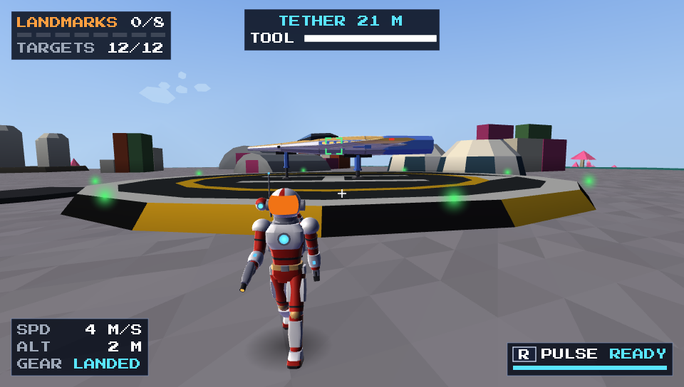
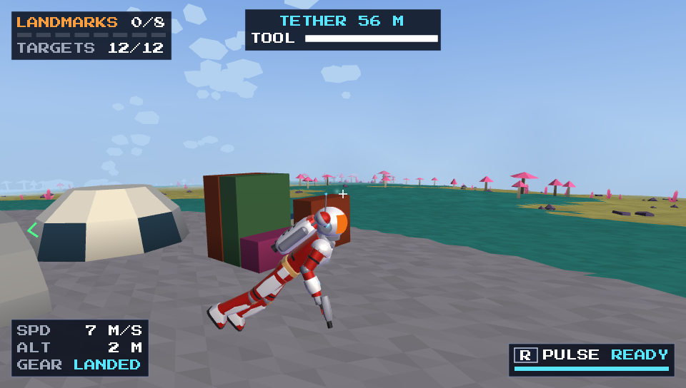
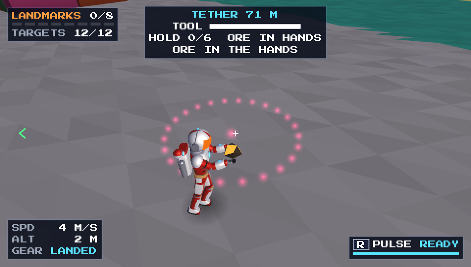
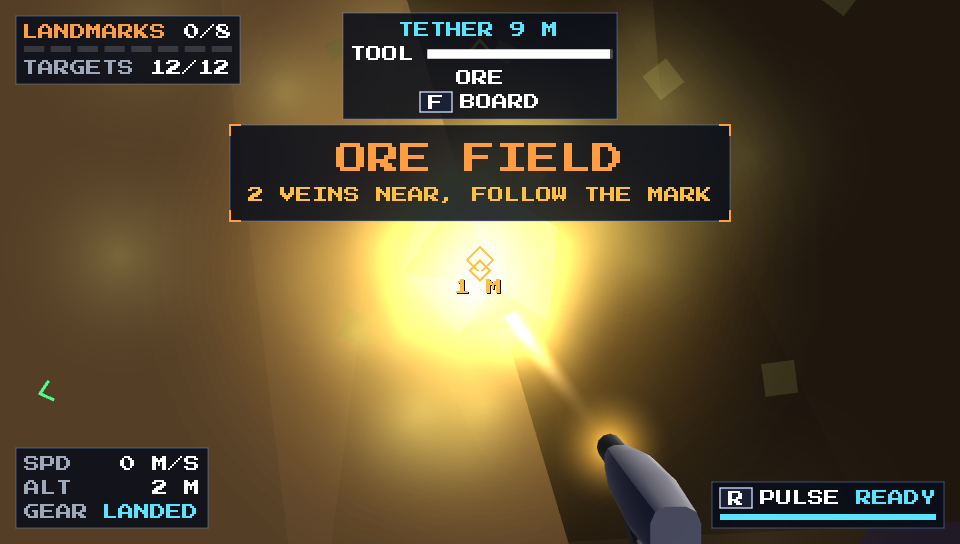

  

  
  
  
  

  <b>A low-poly space exploration game for the PS Vita, the PC, and the Nintendo Switch.</b> 
  Fly from open space down to the surface of small planets. Find old ruins, fight pirates, and solve the secret of the system.

  
  

  <a href="#gameplay-video">Video</a> ·
  <a href="#new-in-02">New in 0.2</a> ·
  <a href="#download">Download</a> ·
  <a href="#features">Features</a> ·
  <a href="#controls">Controls</a> ·
  <a href="#status">Status</a> ·
  <a href="#roadmap">Roadmap</a>

---

## Gameplay video

  

  The video shows the game on the PS Vita. Click the image to watch it on YouTube.

## New in 0.2

Version 0.2 lets you leave the ship. The latest build is [version 0.2.2](https://github.com/DrakonPL/OrbisMinor/releases/tag/0.2.2).

- **Explore on foot.** Land with the gear down and step outside. Walk, run, jump, and fire the suit jet, in the first-person or the third-person view.
- **Dig and mine.** The dig tool cuts pits and tunnels into the planet. Dig into an ore vein, carry the chunks to the hold of your ship, and bank them at a starport or a station.
- **Landing gear and auto landing.** The ship has three landing legs. Fly low and slow, press DOCK, and the ship lands itself.
- **FREE LOOK.** The new default stick layout. The right stick turns the camera round the ship, and the ship keeps its course.
- **Switch buttons on the Switch.** The menus and the hints show A, B, X, Y, +, and −.

The [changelog](CHANGELOG.md) lists the changes since version 0.1.0.

## About the game

*Orbis Minor* is Latin for "a small world". The game puts you in a small solar system of small planets. Every planet has a radius of only 4 km. You can fly round one in a few minutes, and you can see its curve from low altitude.

You are an explorer. Somebody hid a code in the ruins of this system. Each landmark that you find gives you a piece of the code. The full code shows the way to the final site.

> **YOU ARE AN EXPLORER.** 
> YOUR COURSE: ORBIS MINOR, A SMALL SYSTEM 
> OF SMALL WORLDS AND OLD SECRETS. 
> SOMEONE HID A CODE IN ITS RUINS. 
> FIND EVERY PIECE. REACH THE FINAL SITE.

  
  

## How a run works

1. Start in space at the edge of a new solar system.
2. Fly to a planet. Go down through its atmosphere and fly low over the ground.
3. Follow the signal of the scanner to a hidden landmark.
4. Hover near the landmark, or land next to it, to record the find.
5. Collect the pieces of the code on every planet.
6. Fly to the final site in orbit round the sun. Fly through its ring to win the run.

A run takes about 20 to 40 minutes. The run clock stops when you pause. The game keeps your best times.

## Features

### From space to the ground

There is no loading screen between open space and the surface of a planet. You can fly through the asteroid belt, enter the atmosphere, and land on the grass in one flight.

- The cruise drive moves the ship at up to 4 km/s between the planets.
- A mass lock stops the cruise drive near a planet or an enemy.
- The terrain uses a faceted, low-poly style with clouds, seas, coast foam, and sea glint.
- The engines leave trails, and the ship drops a shadow on the ground.
- Three landing legs swing down for a landing. Fly low and slow, press DOCK at the AUTO LAND prompt, and the ship lands itself.

  
  

  
  

### On foot: walk, dig, and mine

Land on a planet with the gear down, then hold DOCK to get out. You can walk up to 200 m from the ship. Board again from any side of the hull.

- **The suit** of the explorer has full animations: walk, run, jump, fall, land, carry, and aim.
- **Two views:** first-person and third-person over the shoulder.
- **The suit jet** gets you out of a deep pit.
- **The dig tool** cuts pits and tunnels into the ground. A ring shows the cut before you press. You can land the ship in a pit and fly it through a tunnel.
- **The fill** puts the rock back.
- **Ore:** each planet has one ore field with 2 to 4 veins. The field appears near your first dig. A HUD mark points to the nearest vein.
- **The hold** of the ship takes 6 chunks of ore. Land on a starport pad or dock at a station to bank them.
- **The save** keeps your digs on up to 4 planets.

  
  

  
  

### A different system for every seed

One seed makes one solar system: 3 or 4 bodies, a sun, and an asteroid belt. At least one body is an airless moon.

- **4 planet types:** temperate, desert, ice, and alien.
- **6 planet traits:** craters, ocean worlds, lava, mesas, ice sheets, and rings. Lava destroys a ship that touches it.
- **21 kinds of flora.** Each planet has 4 to 7 species. Some alien plants glow at night.
- **Landforms:** spires, arches, ice spires, and sea stacks.
- **Surface life:** flocks, floaters, night spores, and geysers.
- **Weather:** dust storms, snow, rain, and ash.

  
  

  
  

  
  

  
  

### Stations and starports

Each planet has a space station or a starport. Each system has at least one of each.

- **Space stations** are in orbit 5 km above the planet. Hold the gear button near the dock, and the ship docks itself.
- **Starports** have 2 to 6 landing pads with lights, a control tower, and buildings.
- Civilian ships take off from the starports and fly between the planets.

  
  

  
  

### Landmarks and secrets

Each planet has 5 to 10 landmarks. One to three of them are tall, and you can see them over the horizon. The scanner finds the others.

- **22 kinds of landmark:** ziggurats, stone circles, crashed ships, observatories, mining rigs, abandoned colonies, floating stones, a world tree, and more.
- **3 cultures** paint the built landmarks: ancient, colonial, and alien.
- **The scanner** shows the signal of the nearest hidden landmark.
- **The scan pulse** marks targets, enemies, and stations in a radius of 10 km.
- **The black monolith** gives 2 pieces of the code. The scanner cannot see it.
- **The Shrine of Old Gods** is on one planet in each system. Two cat statues guard it.
- Each find repairs the hull and adds a hint to the ship log.

  
  

  
  

### Pirates, capital ships, and events

The system is not empty. Pirates patrol in space and in the air of the planets. Some planets have a pirate base.

- **7 enemy types:** 4 pirate ships, from the small raider to the gunship, and 3 guards that protect the landmarks.
- **Capital ships:** corvettes of 60 to 90 m and destroyers of 180 to 260 m. To kill a destroyer, destroy its shield domes first and then its reactor. The wreck drops a data core that marks 2 hidden landmarks.
- **Allies:** green fighters and a navy corvette fight the pirates on your side.
- **Hyperspace arrivals:** a warning banner shows 3 seconds before the ships jump in.
- **8 random events:** ambushes, distress calls, allied patrols, bounties, derelicts, meteor showers, rescues, and more.
- **Aim assist** with a lead ring. A destroyed ship breaks into tumbling pieces.

  
  

  
  

### Ship computer, saves, and options

Press Start to open the ship computer. On the Switch, press +. On a PC keyboard, press Esc. The ship computer has 4 tabs: STATUS, MAP, LOG, and OPTIONS.

- **4 ship styles** for the player: military, luxury, industrial, and explorer. The game builds each ship from parts.
- **3 save slots** with autosave at a dock, after a find, and when you enter a new zone.
- **Options** for gameplay, audio, graphics, and controls.
- **Rebindable controls** with 4 stick layouts and presets.
- **Original music and sound:** 3 music tracks and 19 sound effects. A script makes all of them from code.

  
  
  

## Controls

The default stick layout is FREE LOOK. The left stick steers the ship, and the right stick turns the camera round the ship. The camera goes back behind the ship after you release the stick. You can change every binding in OPTIONS > CONTROLS.

### In the ship

| Action | PS Vita | Nintendo Switch | PC keyboard |
| --- | --- | --- | --- |
| Pitch | Left stick up, down | Left stick up, down | W, S |
| Turn | Left stick left, right | Left stick left, right | A, D |
| Roll | Slide a finger sideways on the rear touch pad | L, R | Q, E |
| Camera | Right stick | Right stick | — |
| Thrust | R | ZR | Space |
| Brake | L | ZL | Left Ctrl |
| Fire | Cross | B | J |
| Boost | Square | Y | Left Shift |
| Landing gear (hold near a dock: auto-dock) | Circle | A | G |
| Dock, auto land, or cruise drive | Triangle | X | F (C: cruise drive) |
| Scan pulse | D-pad up | D-pad up | R |
| Map | D-pad down | D-pad down | M |
| Ship computer, pause | Start | + | Esc |

### On foot

| Action | PS Vita | Nintendo Switch | PC keyboard |
| --- | --- | --- | --- |
| Walk | Left stick | Left stick | W, A, S, D |
| Look | Right stick | Right stick | Arrow keys |
| Run (hold) | Square | Y | Left Shift |
| Jump, pick up ore (hold in the air: suit jet) | Cross | B | J |
| Dig (hold) | R | ZR | Space |
| Fill (hold) | L | ZL | Left Ctrl |
| Get out (hold in the ship), board | Triangle | X | F |
| First-person or third-person view | D-pad right | D-pad right | V |
| Wave | D-pad left | D-pad left | X |

**Other stick layouts:** STANDARD, SWAPPED, and ONE STICK put the roll on a stick. With these layouts, the Switch uses R for thrust and L for brake. On the PS Vita, the REAR ROLL option sets the roll on the rear touch pad: DRAG, ZONES, or OFF. The SELF LEVEL option levels the wings when you do not roll.

The SHOULDER FIRE preset puts fire on R and thrust on the bottom face button.

**Menus:** on the PS Vita, Cross selects and Circle goes back. On the Switch, A selects and B goes back. OPTIONS > CONTROLS > CONFIRM BUTTON swaps the two buttons. On the PC keyboard, the arrow keys move, Enter selects, and Backspace goes back.

**PC gamepads:** Xbox, PlayStation, and Switch Pro controllers work. The buttons have the same positions as on the PS Vita. On a PC gamepad, R2 is thrust and L2 is brake. With FREE LOOK, L1 and R1 roll. Alt+Enter changes between a window and the full screen.

## Download

The latest build is [version 0.2.2](https://github.com/DrakonPL/OrbisMinor/releases/tag/0.2.2). All builds are on the [Releases](https://github.com/DrakonPL/OrbisMinor/releases) page.

| Platform | File |
| --- | --- |
| PS Vita | `OrbisMinor-0.2.2-vita.vpk` |
| Windows PC | `OrbisMinor-0.2.2-win32.zip` |
| Nintendo Switch | `OrbisMinor-0.2.2-switch.zip` |

### PS Vita

You need a PS Vita with homebrew enabled (HENkaku or Ensō) and VitaShell.

1. Download the `.vpk` file from the [latest release](https://github.com/DrakonPL/OrbisMinor/releases/latest).
2. Copy the `.vpk` file to the memory card of the console.
3. Open VitaShell and select the `.vpk` file.
4. Install the file.
5. Start Orbis Minor from the home screen.

The game keeps its saves in `ux0:/data/OrbisMinor/`. When you update the game, install the full `.vpk` file again.

### Windows PC

You need Windows 10 or 11 and a graphics card with OpenGL 4.3. The game needs no installer.

1. Download the `-win32.zip` file from the [latest release](https://github.com/DrakonPL/OrbisMinor/releases/latest).
2. Unzip the folder anywhere.
3. Start `OrbisMinor.exe`.

The first start opens the game borderless on the main monitor. The DISPLAY page of the options sets the mode, the monitor, the resolution, the vsync, and the frame cap.

The game keeps its saves in `%APPDATA%\Andromeda\OrbisMinor`. The `README.txt` file in the zip tells you what to do when the screen stays black.

### Nintendo Switch

You need a Nintendo Switch that can run homebrew, with the Homebrew Menu.

1. Download the `-switch.zip` file from the [latest release](https://github.com/DrakonPL/OrbisMinor/releases/latest).
2. Unzip the file. You get the folder `OrbisMinor`.
3. Copy the `OrbisMinor` folder to the `switch` folder of the SD card.
4. Start the Homebrew Menu.
5. Select Orbis Minor.

Start the Homebrew Menu through a game: hold R when you start a game. The Album gives homebrew less memory.

The game keeps its saves in `sdmc:/switch/OrbisMinor/`, next to the game. When you update the game, copy the new `OrbisMinor` folder over the old one. The saves stay.

## Status

Orbis Minor is in development. The game is not finished.

- The PS Vita build runs the flight and the planets at 60 fps. In tests on the console, a frame took 9.3 ms or less.
- The PC and Switch builds have the same content as the PS Vita build.
- The walk on foot, the dig, and the ore are new in version 0.2. Send a bug report when something goes wrong.
- The Switch build had only a few test runs on the console.
- The first-flight tutorial is not done yet.
- The core loop is still open to change. The [roadmap](#roadmap) below lists what comes next.

This repository holds the presentation of the game and the release builds. The source code is not in this repository.

## Roadmap

Thank you for the feedback on the first release. Most of this list comes from your comments. The order is the planned order of work. It can change.

### Done in 0.2

- **Free-look camera.** The right stick turns the camera round the ship. The ship keeps its course.
- **Leave the ship.** Walk near your landed ship, dig for ore, carry it back, and bank it.
- **Digging.** Holes, pits, and tunnels in the ground of a planet.

### Next: small things with a big effect

- **Landing grades.** A grade for every dive, climb, and touchdown, with a clean mark for a perfect landing.
- **Forests.** Patches of forest and open ground, large and small trees, and bushes.
- **Cores as money.** Relics on the planets hold energy cores. Carry one to a station or a starport on a tow cable, and the bank pays.
- **Planets that react.** A theft or a fight wakes a planet. Hunters come, and a lockdown follows. The alert cools down when you leave.
- **A 30 fps option** for the high detail preset. The default stays 60 fps.

### Then: a galaxy

- **30 to 40 star systems** with real star names, on a chart with jump lanes between neighbors.
- **4 to 8 bodies in a system**, not 3 or 4. The sun at the center, the planets on orbits.
- **New kinds of body:** asteroid belts with their own bases, gas giants that hang in the sky of their moons, deep-space stations, derelict fields, and comets.
- **Charting.** A system shows on the chart after a neighbor reveals it, by a scan or by a chart that you buy.
- **A hidden system.** Ten chart pieces lie hidden across the galaxy, with a clue and no scanner mark. The full chart shows a system that is not on any map, and an artifact waits there.
- **Difficulty by region.** The far side of the galaxy has stronger guards, larger groups, and earlier capital ships.

### Later: a reason to fly

- **Ship upgrades,** sold at the stations for cores: shields, speed, weapons, and one unique artifact.
- **Bounties** for pirate kills.
- **Missions** from ships and stations: kill a group, bring cores, scan a landmark, escort a ship, reach a system, or steal a core from a guarded site while the alert climbs.
- **Shops** with prices that change from system to system, and faces to talk to.
- **New enemy attacks:** lobbed shots, mines, and beams that you can see coming.
- **Fleet battles** between the navy and the pirates, in space and over a pirate base. You pick a side.
- **New ship types** for the pirates and the navy.

### Big: more on foot

- **Co-op for two Vitas** over a local Wi-Fi network.
- **Planets of different sizes.** Under study. Every planet is 4 km today.

## Technical notes

- **Engine:** Andromeda-Lib, the C++ engine of the developer. The PS Vita build uses GXM through [VitaSDK](https://vitasdk.org). The PC build uses OpenGL. The Switch build uses OpenGL through [devkitPro](https://devkitpro.org) and libnx.
- **Screen:** 960 x 544 on the PS Vita, the native resolution. 1280 x 720 on the Switch. When the Switch is docked, the game draws the frame at the TV resolution, up to 1080p. The PC sets the resolution in the DISPLAY options.
- **Anti-aliasing:** 2x MSAA on the PS Vita. The PC sets it in the options.
- **World:** the planets are full spheres with streamed terrain patches. Background threads build each planet zone while you fly.
- **Assets:** code makes the ships, the stations, the landmarks, the music, and the sound effects. The game ships almost no hand-made art.
- **Font:** [Press Start 2P](https://fonts.google.com/specimen/Press+Start+2P) by CodeMan38, under the SIL Open Font License.

  Screenshots come from the PC development build at the Vita resolution of 960 x 544.

